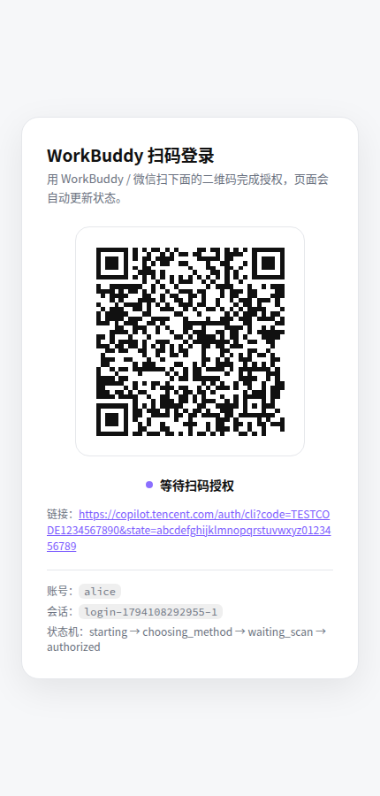
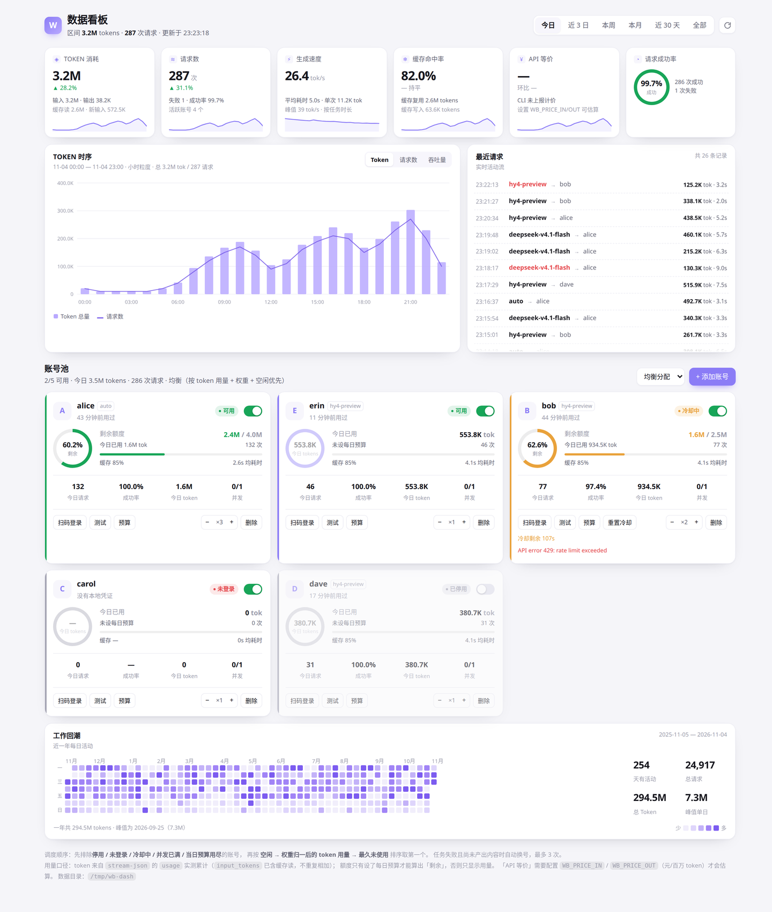
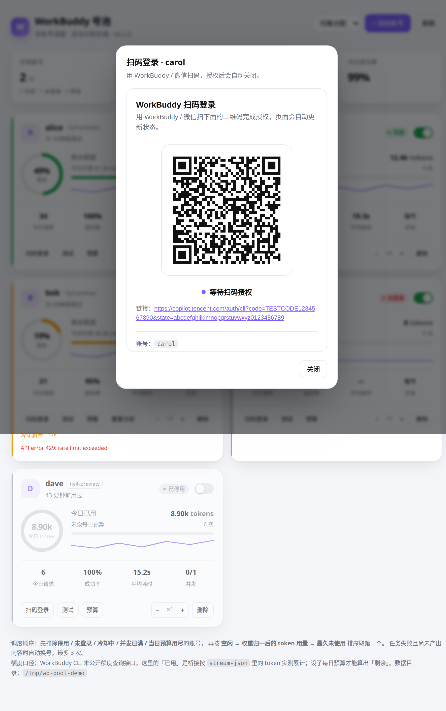

# workbuddy-bridge

> 把 WorkBuddy 接成三种标准入口：**MCP 子 Agent**、**Anthropic Messages API** 与
> **OpenAI Chat Completions / Responses API**。
>
> Claude Code / DeepSeek Harness / Codex / Cursor / OpenCode / Windsurf / Gemini CLI / Cline 通用。
>
> 扫码登录一次，MCP 任务与 API 请求共享同一套账号池和客户端 Key；API 直连
> WorkBuddy 上游，不启动 CLI。运行时要求 Node.js `>=22.13`（Responses 持久化使用内置
> SQLite）。



---

## 这解决什么问题

WorkBuddy 能力很强，但它是「一个 App」。你在 Claude Code 里写代码时想让它顺手处理一下报表、生成 PPT、跑一遍长链路调研，只能切窗口、复制粘贴、再把结果搬回来。

Windsurf、Cursor 这些客户端各有各的 MCP 生态，官方没有提供「反向 MCP」让它们把 WorkBuddy 当子 Agent 调。

本项目提供三条入口：

1. **MCP**：任意 MCP 客户端通过 `workbuddy_task` 把任务交给 WorkBuddy；这条路径仍用 `codebuddy -p` 执行文件类长任务。
2. **Anthropic Messages API**：标准 Anthropic SDK / 客户端直接请求 `/v1/messages`，支持真实流式文本、`tool_use` / `tool_result` 和 `count_tokens`；这条路径直接请求 WorkBuddy 上游，不启动 CLI。
3. **OpenAI Chat Completions / Responses API**：兼容客户端可使用
   `/v1/chat/completions`、`/v1/responses`（HTTP/SSE 与原生 WebSocket）、
   `/v1/models`；支持流式文本、function 工具、思考提示和 Responses 工具协议，
   直接请求 WorkBuddy 上游，不启动 CLI。

三个入口共享扫码凭证、多账号隔离、号池调度、并发限制、用量统计和管理界面：

- **扫码登录**：不用先手工登录一次，Agent 或管理页里直接出二维码；
- **多账号隔离**：一个账号一个独立配置目录和 HOME，公司号 / 个人号互不污染；
- **号池调度**：按权重、用量、并发和冷却选号；401 刷新、429 冷却、失败换号；
- **协议归一化**：把结构化 `tool_calls` 与文本里的 DSML 调用隔离解析，最终只输出一组合法 `tool_use`。

## 架构

```
  Claude Code / DeepSeek Harness / Codex / Cursor / OpenCode / Windsurf …
        │                                 Anthropic / OpenAI SDK 与兼容客户端
        │ MCP (stdio / HTTP)                                   │ HTTP
        │ workbuddy_task / workbuddy_login / …   │ /v1/messages  /v1/chat/completions  /v1/responses
        ▼                                                      ▼
  workbuddy-bridge            ← 本项目
        ├── 账号与凭证：~/.workbuddy-bridge/profiles/<name>
        ├── 扫码登录：PTY 驱动 TUI → 授权链接 → 二维码
        ├── 共享号池：鉴权 / 权重 / 并发 / 冷却 / 记账
        ├── 管理页：账号、用量、API 开关、客户端 Key
        ├── MCP 执行：codebuddy -p --output-format stream-json
        └── API 执行：协议转换 → 上游 SSE → DSML 清洗 → 标准协议响应
             取消/背压 → SQLite 或 0600 死信 → 审计和合法终态
                 │                                      │
                 ▼                                      ▼
       codebuddy CLI（仅 MCP / CLI）        WorkBuddy /v2/chat/completions
                 │                                      │
                 └───────────────► WorkBuddy 服务 ◄─────┘
```

MCP 路径继续使用 CLI，因此登录、文件写入和工具执行语义与 WorkBuddy 本体一致。API 路径使用登录后保存在隔离账号目录中的凭据，直接请求 WorkBuddy 上游；只对已知通道签名做兼容清洗，不复用 reverse-proxy 的 GPL 源码。API 与 MCP 的账号并发、成功率和 token 记账进入同一号池。

## 快速开始

```bash
# 1. 前置：装好 WorkBuddy CLI（只需一次）
npm i -g @tencent-ai/codebuddy-code

# 2. 装桥接
git clone <this-repo> && cd workbuddy-bridge
npm install
npm link          # 之后可以直接用 wb 命令

# 3. 扫码登录（终端里会打出二维码，同时起一个本地登录页）
wb login

# 4. 注册到你已安装的 Agent
wb install

# 5. 有多个号？再登一次
wb login --account alice

# 6. 启动管理页、Anthropic API 与可选 OpenAI API
wb http --port 7666
# 启动后默认地址：
# OpenAI base URL    http://127.0.0.1:7666/v1 （默认关闭）
# Anthropic base URL http://127.0.0.1:7666    （默认开启）
# Admin              http://127.0.0.1:7666/admin
# Health             http://127.0.0.1:7666/health
```

`wb install` 会自动探测并写入：

| 客户端 | 配置文件 |
|:--|:--|
| Claude Code | `~/.claude.json` |
| DeepSeek Harness | `~/.dsh/profiles/<profile>/cordis.patch.yml` |
| Codex CLI | `~/.codex/config.toml` |
| Cursor | `~/.cursor/mcp.json` |
| OpenCode | `~/.config/opencode/opencode.json` |
| Windsurf | `~/.codeium/windsurf/mcp_config.json` |
| Gemini CLI | `~/.gemini/settings.json` |
| Cline (VS Code) | `.../saoudrizwan.claude-dev/settings/cline_mcp_settings.json` |

不在列表里的客户端：`wb install --print` 拿一段通用 JSON，手工粘进去即可。

重启 Agent，然后直接说：

> 让 workbuddy 读一下 ./reports 里的 CSV，出一份中文月度总结

## Anthropic Messages API

启动 `wb http` 后，同一个服务同时提供管理页和 Anthropic 兼容入口：

| 方法与路径 | 说明 |
|:--|:--|
| `POST /v1/messages` | 支持流式 / 非流式文本、图片输入、`tool_use` 和 `tool_result` |
| `POST /v1/messages/count_tokens` | 本地保守估算，响应带 `estimated:true` 与 `estimator:"wb-conservative-v1"` |
| `GET /admin` | 独立开关 Anthropic / OpenAI、Responses 持久化与续跑提示，管理客户端 Key |

官方 SDK 示例：

```js
import Anthropic from '@anthropic-ai/sdk';

const client = new Anthropic({
  // 本机回环连接默认免 Key；远程连接必须在 /admin 生成 Key。
  apiKey: process.env.WB_API_KEY || 'loopback',
  baseURL: 'http://127.0.0.1:7666',
});

const response = await client.messages.create({
  model: 'deepseek-v4.1-flash',
  max_tokens: 256,
  messages: [{ role: 'user', content: '只回答两个字：收到' }],
});

console.log(response.content);
```

工具由客户端执行。服务端只返回 Anthropic `tool_use`；客户端执行工具后，用同一个 ID 回传 `tool_result`，下一轮请求即可继续对话：

```js
const first = await client.messages.create({
  model: 'deepseek-v4.1-flash',
  max_tokens: 512,
  tools: [{
    name: 'read_file',
    description: '读取一个文本文件',
    input_schema: {
      type: 'object',
      properties: { path: { type: 'string' } },
      required: ['path'],
    },
  }],
  messages: [{ role: 'user', content: '读取 ./README.md 并总结' }],
});

const toolUse = first.content.find((block) => block.type === 'tool_use');
if (toolUse) {
  const messages = [
    { role: 'user', content: '读取 ./README.md 并总结' },
    { role: 'assistant', content: first.content },
    {
      role: 'user',
      content: [{
        type: 'tool_result',
        tool_use_id: toolUse.id,
        content: '客户端执行工具后得到的文本结果',
      }],
    },
  ];
  await client.messages.create({
    model: 'deepseek-v4.1-flash',
    max_tokens: 512,
    tools: [/* 与上一轮相同 */],
    messages,
  });
}
```

### API 行为与边界

- **共享登录与号池**：读取现有扫码账号的隔离凭证，使用相同的权重、`maxConcurrency`、401 刷新、429 冷却和记账逻辑；不需要单独登录。
- **不启动 CLI**：`/v1/messages` 直接访问 WorkBuddy 上游。移除本机 `codebuddy` 命令后，API 仍可工作；MCP / `wb task` 才会依赖 CLI。
- **鉴权**：回环地址默认免客户端 Key；非回环连接、`requireApiKey=true` 或 `trustProxy=true` 时必须提供 `x-api-key` 或 `Authorization: Bearer`。管理页只保存 Key 的 SHA-256 摘要，明文仅展示一次。
- **真实流式**：可见文本到达即转发。工具调用延后到响应结束统一裁决，随后按 Anthropic 事件格式追加 `tool_use` blocks。
- **结构优先**：合法结构化 `tool_calls` 优先；只有结构化调用全部无效时才回退到文本 DSML。两者同时有效会记录安全 warning，只包含模型、请求 ID、账号、数量和参数哈希，不记录原始参数。
- **DSML 上限**：扫描器默认最多缓冲 2 MiB。超限、畸形或截断时失败关闭，不向正文泄漏 DSML，流式错误后不发送 `message_stop`。
- **四层超时**：首字节 60 秒、流中空闲 120 秒、`finish_reason` 后宽限 2 秒、总时长 600 秒。流开始后无法安全换号，只会终止当前响应；账号 inflight 始终释放。
- **SSE 保活**：`message_start` 后每 15 秒发送一次 Anthropic `ping`，防止下游代理因短暂无事件而断开。ping 不代表上游出现了新内容。
- **乱序工具结果**：user message 中排在 text/image 后的 `tool_result` 会自动移到最前，并保持 result 组与剩余块各自的相对顺序；引用未知 `tool_use_id` 的请求返回 400。

`count_tokens` 是确定性本地估算，不是 Anthropic 官方 tokenizer。中英文混合和长上下文可能有明显误差，**不得用于精确计费或裁剪刚好达到上下文上限的请求**；实际请求仍应处理上游的 `context_length_exceeded`。

## OpenAI Chat Completions / Responses API

管理页的 **OpenAI 协议** 开关只控制 OpenAI 路由；默认保持关闭，开启后可通过
同一端口使用以下接口（管理页继续提供独立 OpenAI 开关）：

| 方法与路径 | 当前范围 |
|:--|:--|
| `POST /v1/chat/completions` | 流式 / 非流式文本、图片、function 工具与多轮 `tool` 续传 |
| `POST /v1/responses` | 非流式 JSON、SSE、`previous_response_id` 续接 |
| `WS /v1/responses` | 原生 `response.create` / `response.interrupt` 命令 |
| `GET /v1/responses/:id` | 查询保存的完成或取消片段 |
| `GET /v1/models` | 优先读取 WorkBuddy 模型目录；不可用时返回带 `wb_source:"fallback"` 的稳定列表 |
| `GET /v1/models/:id` | 查询目录中的单个模型；未找到返回 `404 model_not_found` |

```js
import OpenAI from 'openai';

const client = new OpenAI({
  apiKey: process.env.WB_API_KEY || 'loopback',
  baseURL: 'http://127.0.0.1:7666/v1',
});

const response = await client.chat.completions.create({
  model: 'deepseek-v4.1-flash',
  stream: false,
  messages: [{ role: 'user', content: '只回答两个字：收到' }],
});

console.log(response.choices[0].message.content);
```

OpenAI 工具由客户端自行执行。把响应中的 assistant 消息和带相同 `tool_call_id`
的 `role:"tool"` 结果加入历史，再发起下一轮：

```js
const tools = [{
  type: 'function',
  function: {
    name: 'read_file',
    description: '读取一个文本文件',
    parameters: {
      type: 'object',
      properties: { path: { type: 'string' } },
      required: ['path'],
    },
  },
}];
const messages = [{ role: 'user', content: '读取 README.md' }];
const first = await client.chat.completions.create({
  model: 'deepseek-v4.1-flash',
  messages,
  tools,
});
const message = first.choices[0].message;
const call = message.tool_calls?.[0];
if (call) {
  messages.push(message);
  messages.push({
    role: 'tool',
    tool_call_id: call.id,
    content: '客户端执行工具后的文本结果',
  });
  await client.chat.completions.create({
    model: 'deepseek-v4.1-flash',
    messages,
    tools,
  });
}
```

OpenAI 与 Anthropic 路由共用客户端 Key，也共用现有号池和扫码登录凭据。管理页 OpenAI
开关默认关闭，开启后生效；关闭时会同时关闭 Responses 持久化和续跑提示，这两个子开关
不能单独越过 OpenAI 主开关。协议边界如下：

> 当前适配目标是主流 SDK 的可互操作子集。Chat 旧的 `functions`、Responses 的
> `file_id` 与未声明工具类型不会被静默接受，而是返回明确 400。

- Chat `stream: true` 返回标准 SSE：文本立即转发，思考提示透传
  `reasoning_content`，最后只发送一个合法的 `finish_reason` 和 `[DONE]`。生产环境每
  15 秒发送不超过 15 秒间隔的 keepalive 空 `choices` chunk，不伪造完成或工具调用。
- `tools` 支持 OpenAI function 工具；`tool_choice` 支持 `auto` / `none` /
  `required` / 指定函数。历史 assistant `tool_calls` 与 `role:"tool"` 的
  `tool_call_id` 可续传。关闭 API 配置中的工具开关时返回
  `400 tools_disabled`；旧版 `functions` / `function_call` 返回
  `400 tools_not_supported`。Chat 当前不支持 `parallel_tool_calls`；Responses
  支持 `parallel_tool_calls:false` 和 `allowed_tools`。
- 工具声明优先使用上游结构化 `tool_calls`；仅在结构调用无效时使用已有 DSML
  扫描器恢复文本形调用。未声明 tools 时清洗 DSML，不向客户端泄漏标记。
- Chat 与 Responses 接受 URL 和 data URL 图片；`file_id` 明确返回
  `400 file_id_not_supported`，不读取或上传文件。
- Responses 支持 `function`、`custom`、`namespace`、`local_shell`、`shell`、
  `apply_patch` 工具声明；不支持的工具返回 `400 unsupported_tool_type`。Response
  的 reasoning 事件来自上游文本，不代表新增了独立的私有推理通道。
- 上游给出 `finish_reason` 前的无完成原因断流会失败关闭并返回
  `502` / Responses failed 事件，不把半截回答伪装成正常完成。Responses 的
  `length` 截断返回 `status:"incomplete"`：明确达到 `max_output_tokens` 时原因是
  `max_output_tokens`，否则是扩展原因 `upstream_length_limit`。
- Chat 的 `n` 只能为 `1`。Embeddings、Audio、Batch、Fine-tuning 不在本次范围；
  Responses 的 `file_id`、MCP server/container 等未实现工具类型也明确拒绝。
- 客户端 Key、协议开关、错误形状沿用共享的 API 兼容层；远程访问仍需配置 Key。

Responses 的持久化和可靠性规则：

- `store:true` 且管理设置开启 `responsesPersistence` 时，完成响应和主动取消/断连的
  可见片段写入 `node:sqlite` 数据库；最多 256 条、32 MiB、24 小时，内存热缓存最多
  64 条。`previous_response_id` 续接会按 `call_id` 配对工具历史，并支持内嵌 item 和
  output 早于 call 的稳定排序。
- SQLite 事务写入预算 2 秒；数据库失败时才写独立 JSONL 死信，权限固定 `0600`，
  预写、`response_id` 幂等，进程启动只重试一次，成功保存后原子移除。普通 RST 或
  WS 断连在 SQLite 成功时不会虚报死信成功。
- 主动取消先停止上游读取、释放号池租约、持久化片段，成功后才发送协议收尾。Chat 使用
  合法 `finish_reason:"stop"` + 单一 `[DONE]`；Anthropic 使用
  `message_delta(stop_reason:"canceled")` + `message_stop`。RST 不伪造成功取消，
  只保存已经可见的正文；半截工具参数不成为可执行调用，失败和超时也不伪装成取消。
- SSE 生产 keepalive 为 15 秒；流控软阈值 256 KiB、硬阈值 1 MiB。硬阈值触发时立即
  取消上游、释放租约并以 `BACKPRESSURE_OVERFLOW` 审计，writer 不保留无限原始事件或
  已发送正文。
- Responses WebSocket 同一连接最多持有一条活动生成租约；新 `response.create` 先中断
  并等待旧租约释放。主动 Close、RST、连接消失和心跳超时走同一个幂等取消路径。
  服务端协议 Ping 为 15 秒，Pong 宽限 10 秒；超时后先取消上游、释放租约，再关闭传输。
  测试夹具可用短间隔注入这些阈值，生产固定为 15 秒 / 10 秒。

Anthropic 的 thinking、文档附件、图片形式的 `tool_result` 和流式响应中的工具块
原位交错暂不支持；遇到不支持的 content block 返回 400。

## 号池：多账号 + 自动分配负载

v0.2 起，多个扫码账号不再只是「手动切换」，而是一个可调度的池子。`workbuddy_task` 不指定 `account` 时默认 `auto`，由调度器挑号；某个号挂了会自动换下一个。v0.3 补了完整用量看板；v0.4 加入 Anthropic API、DSML 安全归一化和共享号池的 API 并发控制；OpenAI Chat Completions 与 Responses 沿用同一号池、鉴权层和持久化取消路径。



### 调度规则

每一轮选号按顺序做两件事：

1. **硬过滤**：停用 / 未登录 / 冷却中 / 并发已满 / 当日预算用尽 → 本轮不参与
2. **排序取第一个**：
   - `balanced`（默认）：先给当前没在跑的号（突发流量不叠在同一个号上），再比「当日 token ÷ 权重」，最后比「最久未使用」
   - `round-robin`：按权重展开成环形队列顺序轮转，游标持久化，跨进程也能保持均匀

失败处理：

| 情况 | 处理 |
|:--|:--|
| 未登录 / 登录失效 | 标记 `unauthorized`，立刻换下一个号；重新扫码后自动恢复 |
| 429 / 额度不足 | 按失败模型指数退避冷却 1 → 2 → 4 … 分钟，上限 30 分钟；该模型暂不接活 |
| 超时 / 调用方取消 | 不重试，原样返回 |
| 其他错误 | 记一次失败，原样返回 |

429 冷却记录绑定到请求模型，不把账号整体判死：同一账号显式请求其他模型仍可调度。
桥接不会因为 429 自动切换模型，默认模型和调用方指定的模型保持不变。旧版账号级冷却
记录仍按“全部模型冷却”迁移，直到自然过期或手动重置。

**换号有个前提**：任务还没产出任何内容。已经写了文件、或已经吐出半截答案的任务不会重跑——重复执行的副作用比失败更麻烦。

### 额度怎么算

WorkBuddy 没有公开的额度查询接口，桥接只使用 CLI 或 API 实际返回的用量，所以这里刻意不编数字：

- **已用**：真实数据。MCP 路径从 CLI `result.usage` 取 `input_tokens` / `output_tokens` / `cache_read_input_tokens`；API 路径从上游 `usage.prompt_tokens` / `completion_tokens` 记账。
  实测 CLI 0.2.x 的 `input_tokens` **已经包含**缓存读取部分，所以总输入就是 `input_tokens`，不再二次相加——之前多算一遍会让用量虚高近一倍
- **剩余**：需要给账号设一个每日预算（`budgetTokens`）。设了才算得出剩余和百分比，并据此停派；不设就只显示用量，不做拦截
- **缓存命中率** = `cache_read_input_tokens ÷ input_tokens`
- **费用**：优先用 CLI 返回的 `total_cost_usd`；没有就按 `WB_PRICE_IN` / `WB_PRICE_OUT` 估算；两者都没配时显示未上报计价，不猜

明细保留：小时桶 16 天、天桶 400 天、最近请求 160 条。够画一整年热力图，又不会让 `pool.json` 无限膨胀。

如果你们的部署能拿到官方额度（企业网关、内部计费接口等），可以用 `WB_QUOTA_CMD` 把真数据接进面板：

```bash
export WB_QUOTA_CMD='my-quota --account "$WB_ACCOUNT" --json'
# 需要输出：{"limit":120000,"used":48000,"remaining":72000,"unit":"tokens"}
```

调度仍以本地预算为准，外部额度只用于展示——避免一个探针失败就把整池停掉。

### 管理界面

```bash
wb http --port 7666   # 管理页默认 http://127.0.0.1:7666/admin
# 或只开管理服务：wb admin（默认 7667）
```



**顶部看板**，区间可切今日 / 近 3 日 / 本周 / 本月 / 近 30 日 / 全部：

| 区块 | 内容 |
|:--|:--|
| KPI | Token 消耗（输入 / 输出 / 缓存读写拆分）、请求数、生成速度、缓存命中率、API 等价费用、成功率环 |
| 时序图 | Token / 请求数 / 吞吐量三视图，柱状叠折线，悬停看逐点明细；按区间自动切小时或按天聚合 |
| 最近请求 | 实时活动流：时间、模型、账号、token、耗时，失败的标红 |
| 工作回顾 | GitHub 风格年度热力图，按 token 量分五档；右侧是活跃天数、总请求、总 token、峰值日 |

环比取「等长的上一段」：今日对昨日同时段、本周对上周、30 天对前 30 天。「全部」区间没有上一段，显示 `—`。

**账号池**每张卡上能看到：

- **额度**：剩余 token / 预算、今日已用、缓存占比、7 日用量曲线；没设预算时明确显示「未设每日预算」，不会假装是 0
- **负载**：今日请求数、成功率、今日 token、当前并发 / 上限、平均耗时
- **状态**：可用 / 冷却中（带倒计时）/ 未登录 / 已停用，左侧色条同步
- **操作**：扫码登录（弹窗直接出二维码）、测试、设预算、重置冷却、调权重、启停、删除

**API 兼容区**支持：

- API 总开关，以及 Anthropic 与 OpenAI Chat Completions / Responses 的独立协议开关；
- 流式响应、工具调用、通道兼容清洗的运行时开关；OpenAI Chat 在关闭流式后会对 `stream:true` 返回 `400 streaming_disabled`；
- Responses 持久化与续跑提示的独立开关；OpenAI 关闭时二者不可用，持久化关闭时续跑提示不可用；
- 上游地址、默认模型（默认 `deepseek-v4.1-flash`）、首字节 / 空闲 / 总超时和 DSML 缓冲上限；
- 鉴权策略：所有连接要求 Key、远程连接要求 Key、信任反向代理；
- 客户端 Key 生成、全部重置、明文一次性查看 / 复制、掩码列表和删除；
- “测试 OpenAI 文本”和“测试 Anthropic 工具”：两者都走实际 runtime 与号池租约；Anthropic 测试执行一次 `tool_use` → `tool_result` 两轮探测，结果只显示 `ok`、账号、耗时和错误码，不显示提示词、token、完整 Key 或工具原文。

顶部汇总可用账号数与状态分布，策略下拉即时生效。看板数据走 `GET /api/stats?range=today|3d|week|month|30d|all`，前端每 5 秒轮询一次。

### 命令行

```bash
wb pool                        # 表格总览
wb pool strategy round-robin   # 切换策略
wb pool weight alice 3         # 权重调到 3
wb pool disable alice          # 停用
wb pool reset alice            # 清冷却与失败计数
wb pool test alice             # 发一条最小请求验证
```

> 并发计数是进程内运行态，重启后自动归零。同一个 bridge 进程内的 MCP 任务和 API 流会共同遵守账号的 `maxConcurrency`；如果分别启动多个 stdio MCP 进程或多个 HTTP 服务，各进程会独立计数，需要全局并发限制时应统一连接同一个 HTTP 服务。

## 扫码登录怎么工作的

`codebuddy` 没有 `login` 子命令——登录界面是启动时渲染的 Ink TUI。所以桥接用伪终端把它跑起来，代替人做三件事：

1. 在 `Select login method` 里按上下键选站点（默认国内站）、回车；
2. 从 TUI 输出里把授权链接抠出来；
3. 盯着它什么时候真正拿到凭证。

新版 CLI 未登录时可能先显示主界面，提交一条消息后才进入登录流程；授权链接也可能只写进本账号日志。桥接会识别这两种情况，且只读取当前账号新增日志中的链接。链接提取做了四层，因为 Ink 还会把长 URL 折行、因重绘重复输出：

| 层级 | 手段 | 说明 |
|:--|:--|:--|
| 1 | OSC 8 超链接 | 终端里可点击的链接，URL 完整不折行，最可靠 |
| 2 | 去换行整体匹配 | Ink 折行不插空格，拼起来就是完整 URL |
| 3 | 逐行 + 尾部清洗 | 兜底，去掉粘在尾巴上的 `Waiting for auth` 之类 UI 文案 |
| 4 | 账号日志兜底 | 只读取本账号新增的 `Opening auth URL` 行，避免串号或使用旧链接 |

拿到链接后：终端直接画二维码；同时若开了 `wb http`，手机浏览器打开 `http://<局域网IP>:7666/login` 也能看到同一张码。

授权完成由 CLI 自己轮询感知，**不依赖手机回调到本机端口**，所以在远程服务器上也成立。

### 三种场景怎么选

| 场景 | 推荐做法 |
|:--|:--|
| 本机开发（有浏览器） | `wb login`，终端扫码即可 |
| 局域网服务器 | `wb login` + `wb http --host 0.0.0.0`，手机连同一 WiFi 打开登录页 |
| 无浏览器的云主机 / 容器 | 本机 `wb login` → `wb export` → 拷到服务器 → `wb import` |

第三种是很多人真正会遇到的情况。镜像里连 TUI 都跑不起来（被强制 headless），扫码无从谈起，搬凭证反而最省事：

```bash
# 你的笔记本
wb login --account work
wb export work.tgz --account work

# 服务器
scp work.tgz server:~/
wb import work.tgz --account work
wb doctor            # 确认已登录
```

> `export` 出来的包里有 token，等同于账号权限。文件权限已强制 600，别传公网、别进 git。

## DeepSeek Harness（dsh）接入细节

dsh 的配置模型和别的客户端都不一样，有两点容易踩坑，`wb install` 已经替你处理：

**1. 它不是 `mcpServers` JSON，而是一份 YAML patch 层。**

用户层在 `~/.dsh/profiles/<profile>/cordis.patch.yml`，顶层是数组，插入插件要用 `insert`：

```yaml
- insert:
    - id: mcp-workbuddy
      name: '@deepseek-ai/dsh-mcp-client'
      config:
        serverName: workbuddy
        transport: stdio
        command: '/usr/local/bin/node'
        args:
          - '/opt/workbuddy-bridge/src/server.js'
```

**2. MCP 客户端本身是个插件，版本必须和 dsh 本体对齐。**

dsh 在启动时会做兼容性检查，不匹配就把整行**静默禁用**，日志里只留一句：

```
dsh: disabling profile plugin row "mcp-workbuddy": Plugin @deepseek-ai/dsh-mcp-client@0.0.1-rc.1
is incompatible with dsh 0.2.1-rc.5 ...
```

偏偏 npm 上 `@deepseek-ai/dsh-mcp-client` 的 `latest` 标签还停在 `0.0.1-rc.1`（2026-11 时），直接 `pnpm add` 装到的就是这个老版本。所以桥接会先读出你的 dsh 版本，再装同版本号的插件（如 `@deepseek-ai/dsh-mcp-client@0.2.1-rc.5`）。手动安装时务必带上版本：

```bash
cd ~/.dsh/profiles/web
pnpm add @deepseek-ai/dsh-mcp-client@$(dsh --version)
```

配置生效后，工具在 dsh 里叫 `mcp__workbuddy__workbuddy_task`（MCP 服务器限定命名），其余用法不变。

> `wb install` 会写入 `~/.dsh/profiles/` 下所有已初始化的 profile。设 `WB_DSH_SKIP_PLUGIN_INSTALL=1` 可跳过插件安装、只写配置。

## 工具一览

| 工具 | 作用 |
|:--|:--|
| `workbuddy_task` | 核心。把任务交给 WorkBuddy，返回最终文本；文件写到 `cwd` |
| `workbuddy_login` | 返回二维码（图片 + 终端字符画 + 链接），发起登录 |
| `workbuddy_login_status` | 查进度；`confirm=true` 可在自动检测失灵时手动确认 |
| `workbuddy_pool` | 查看号池负载与额度；切策略、启停、调权重、清冷却 |
| `workbuddy_accounts` | 列出 / 切换默认 / 删除账号 |
| `workbuddy_doctor` | 环境自检 |

`workbuddy_task` 参数：

```jsonc
{
  "prompt": "整理 ./data 下的销售数据，输出 xlsx 和一段结论",  // 必填
  "cwd": "/path/to/project",   // WorkBuddy 读写文件的位置
  "model": "deepseek-v4.1-flash", // 默认模型
  "fallbackModel": "deepseek-v4.1-flash",  // 主模型限流时自动回退
  "timeoutMs": 900000,
  "account": "auto"   // 默认 auto = 号池自动挑；填具体名字则强制用该号，不做故障切换
}
```

长任务会通过 MCP progress 通知持续汇报，避免客户端以为卡死。

## 多账号

一个账号 = 一个独立的 `CODEBUDDY_CONFIG_DIR` + `HOME`。CodeBuddy 会把认证文件写在 `HOME` 下，所以两者必须一起隔离：

```bash
wb login --account work     # 公司号
wb login --account personal # 个人号
wb accounts use work
```

Agent 里也可以指定：`workbuddy_task(..., account: "personal")`。

不指定时默认 `auto`：由号池按负载挑号，某个号掉登录或被限流会自动换下一个。`wb accounts use` 设的「默认账号」只在显式不启用号池时作为兜底。

### 站点选择

```bash
wb login --site cn          # 国内站（默认）
wb login --site intl        # 国际站
wb login --site enterprise  # 企业专享版
wb login --site ioa         # 腾讯内网
```

## 配置

| 环境变量 | 默认 | 说明 |
|:--|:--|:--|
| `WB_COMMAND` | `codebuddy` | MCP / CLI 任务的命令路径；Anthropic / OpenAI API 不读取该命令 |
| `WB_BRIDGE_HOME` | `~/.workbuddy-bridge` | 桥接数据目录 |
| `WB_DEBUG` | – | `1` 打调试日志 |
| `WB_QUOTA_CMD` | – | 可选，外部额度探针命令，输出 JSON 供面板显示 |
| `WB_ADMIN_TOKEN` | – | 可选，给 `/admin`、号池、统计和 API 兼容管理接口加访问令牌 |
| `WB_PRICE_IN` | – | 输入价（元 / 百万 token），用于估算费用 |
| `WB_PRICE_OUT` | – | 输出价（元 / 百万 token） |
| `WB_PRICE_CACHE` | 输入价一折 | 缓存读取价（元 / 百万 token） |
| `WB_USD_CNY` | `7.2` | CLI 返回美元成本时用的汇率 |

`~/.workbuddy-bridge/config.json` 里可改默认模型、超时、是否自动授权：

```jsonc
{
  "defaultAccount": "work",
  "defaults": {
    "model": "auto",
    "fallbackModel": "deepseek-v4.1-flash",
    "timeoutMs": 900000,
    "skipPermissions": true
  },
  "apiCompat": {
    "enabled": true,
    "openai": false,
    "anthropic": true,
    "anthropicEnabled": true,
    "responsesPersistence": true,
    "responsesNudge": false,
    "requireApiKey": false,
    "remoteRequireKey": true,
    "trustProxy": false,
    "defaultModel": "deepseek-v4.1-flash",
    "dsmlMaxBufferBytes": 2097152,
    "firstByteTimeoutMs": 60000,
    "idleTimeoutMs": 120000,
    "finishGraceMs": 2000,
    "totalTimeoutMs": 600000
  }
}
```

客户端 Key 摘要存放在 `apiCompat.keys`，配置文件权限为 `0600`。一般通过管理页生成和删除，不需要手改。

号池状态单独一份 `~/.workbuddy-bridge/pool.json`：

```jsonc
{
  "strategy": "balanced",        // balanced | round-robin
  "maxAttempts": 3,              // 单次任务最多试几个号
  "accounts": {
    "alice": {
      "enabled": true,
      "weight": 2,
      "maxConcurrency": 1,
      "budgetTokens": 120000,    // 0 = 不限额
      "today": { "req": 34, "ok": 34, "tokensIn": 50184, "tokensOut": 11016, "ms": 727600 }
    }
  }
}
```

一般不用手改：`wb pool …` 和管理界面都是写这个文件。

## 安全说明

- **默认自动授权（仅 MCP / CLI）**：任务会带 `--dangerously-skip-permissions`，WorkBuddy 请求的文件/网络操作直接执行。要留人工确认，把 `skipPermissions` 设成 `false`。
- **凭证在本地**：扫码凭证保存在 `~/.workbuddy-bridge/profiles/<name>`。Anthropic / OpenAI API 会读取该凭据直连上游，刷新后的 token 以原子写入和 `0600` 权限回写原文件；日志和测试输出不得打印 access token、refresh token 或客户端 Key 明文。
- **客户端 Key 只存摘要**：管理页生成后只展示一次明文，配置中只保存 SHA-256 摘要。非回环访问默认强制 Key；不要为了图省事关掉远程鉴权。
- **DSML 失败关闭**：识别到 DSML envelope 后，畸形、截断或超过 2 MiB 会终止响应，不回退为工具调用，也不把原始标记混入正文。
- **stdio 不污染**：MCP 的 stdout 是协议通道，桥接所有日志走 stderr 和 `~/.workbuddy-bridge/logs/`。
- **导出包敏感**：`wb export` 的 tgz 等同账号权限，自行保管。
- **管理界面默认只监听 127.0.0.1**：`wb http --host 0.0.0.0` 会把账号、Key 和 API 管理能力暴露到网络；务必同时设置 `WB_ADMIN_TOKEN`，并给远程 API 客户端配置独立 Key。

## 常见问题

**需要 WorkBuddy 桌面端开着吗？**
不需要。MCP / CLI 任务驱动本机 `codebuddy`，Anthropic / OpenAI API 直接请求 WorkBuddy 上游，二者都能独立运行。

**没有 `codebuddy` 命令，Anthropic / OpenAI API 还能用吗？**
能。只要账号目录里已有可用扫码凭证，API 不启动 CLI。MCP、`wb task` 和扫码登录流程仍需要 CLI。

**Agent 里看不到我让它生成的文件？**
文件写在 `cwd`，不会自动进入 Agent 上下文。让它 `cat` 或 `read` 一下就行。

**登录一直卡在 waiting_scan？**
先确认手机上是否真的点了授权；二维码有有效期，超时重新 `wb login`。若 CLI 在你这台机器上根本不渲染 TUI（容器里常见），改用 `wb export` / `wb import`。

**Windows 上扫码失败？**
`node-pty` 是可选的，没装时 Linux/macOS 走系统 `script` 命令，Windows 没有等价物。装一下即可：

```bash
npm i -g node-pty
```

**任务被客户端掐断？**
多数 MCP 客户端对单次工具调用有超时上限。把 `timeoutMs` 设小一点先拿中间结果，或改用 `wb http --mcp` 走 HTTP 传输。

**Anthropic / OpenAI SDK 报 401？**
回环地址默认免 Key；如果配置了 `requireApiKey=true`、从非回环地址访问，或经过可信反向代理，就需要在 `/admin` 生成 Key，并通过 `x-api-key` / `Authorization: Bearer` 发送。

**原来的 OpenAI 示例为什么还能用？**
Chat Completions 保持兼容并新增 SSE 与图片；要使用 Responses，可直接把 base URL
指向 `http://127.0.0.1:7666/v1`，开启管理页的 OpenAI 开关。`previous_response_id`
只在此前请求带 `store:true` 且持久化开启时生效。

**取消后还能续跑吗？**
可以。请求带 `store:true` 且 Responses 持久化开启时，取消会保存可见文本片段；用
`GET /v1/responses/:id` 查询该 `incomplete` 响应，再把它的 ID 作为
`previous_response_id`。不会保存半截工具参数，也不会把失败或上游超时标成取消。

**流式响应为什么只看到文本，工具块最后才出现？**
首版优先保证安全裁决：结构化工具调用和 DSML 都要等到上游结束才能确定最终结果。可见文本仍实时输出，`tool_use` 在响应末尾统一追加。

**Responses API 为什么需要 Node.js 22.13 或更高？**
Responses 的持久化直接使用 Node 内置 `node:sqlite`，不引入原生第三方数据库依赖；低于该版本的环境无法提供所需模块，启动持久化请求时会失败。

## 开发

```bash
npm test
npm run test:live
```

### 测试约定

**测试统一使用 `deepseek-v4.1-flash`。**

- 离线测试（`npm test`）不真正调用模型；假 CLI 的回包和断言里的模型名固定为 `deepseek-v4.1-flash`，不会引入未使用的旗舰模型名
- 需要真实链路验证时使用 `test:live`，默认模型固定为 `deepseek-v4.1-flash`：

```bash
npm run test:live
```

它会启动回环 HTTP 服务、使用现有账号池请求真实上游，并额外调用 `count_tokens`；脚本故意选择不存在的 `WB_COMMAND`，以验证 API 路径没有启动 CLI。输出只包含模型、字符数、估算标记和成功状态，不打印 token、客户端 Key、access token 或 refresh token。

慢读和内存上限可单独执行：

```bash
npm run test:load
```

该命令测量匿名 RSS、进程峰值 RSS、heap、external、writer 峰值 pending 字节、
上游是否被取消和租约是否归零；子进程使用有界 V8 old generation 与 semi-space，
硬阈值触发后必须确定退出。

也可以让脚本连接已经运行的 bridge：

```bash
WB_LIVE_BASE_URL=http://127.0.0.1:7666 \
WB_LIVE_API_KEY='<客户端 Key>' \
npm run test:live
```

复杂推理模型可能单价高、排队久，不建议拿它跑测试；功能联调用
`deepseek-v4.1-flash` 足够，复杂推理只在人工验收时单独执行。

默认 `npm test` 为离线测试，不联网、不消耗模型额度。覆盖 DSML 字符 / UTF-8
字节切分、2 MiB 熔断、结构化与 DSML 仲裁、Anthropic 请求转换、OpenAI Chat
流式 / 非流式、Responses HTTP/SSE/WS、模型目录、协议错误边界、SSE 双重 JSON
转义、官方 SDK 三轮 `tool_use/tool_result`、401 刷新、429 换号、并发上限、
SQLite 持久化和死信、主动取消、RST、WS Close、TCP 假死、慢读 keepalive、1 MiB
背压以及四层超时。管理页已做桌面端验收，不包含移动端验收。

## 官方 wire-shape 验收样例

以下命令要求 `wb http` 已启动、对应协议已在 `/admin` 开启，并已生成客户端 Key。
把 `WB_API_KEY` 只放在当前 shell 环境变量中；不要把真实 Key 写入脚本、日志或仓库。

OpenAI 非流式：

```bash
curl http://127.0.0.1:7666/v1/chat/completions \
  -H "Authorization: Bearer $WB_API_KEY" \
  -H "Content-Type: application/json" \
  -d '{"model":"deepseek-v4.1-flash","messages":[{"role":"user","content":"只回复 ok"}],"stream":false}'
```

OpenAI 流式：

```bash
curl -N http://127.0.0.1:7666/v1/chat/completions \
  -H "Authorization: Bearer $WB_API_KEY" \
  -H "Content-Type: application/json" \
  -d '{"model":"deepseek-v4.1-flash","messages":[{"role":"user","content":"数到 3"}],"stream":true}'
```

Anthropic 非流式：

```bash
curl http://127.0.0.1:7666/v1/messages \
  -H "x-api-key: $WB_API_KEY" \
  -H "anthropic-version: 2023-06-01" \
  -H "Content-Type: application/json" \
  -d '{"model":"deepseek-v4.1-flash","max_tokens":64,"messages":[{"role":"user","content":"只回复 ok"}]}'
```

这些是可选的真实链路样例，不属于默认 `npm test`。默认测试使用本地假上游与官方 SDK
离线校验同一条 wire-shape；工具往返分别覆盖 Anthropic `tool_use/tool_result` 与
OpenAI `tool_calls` + `role:"tool"`。

**wire-shape 回归**由离线假上游和官方 SDK 测试共同锁定：`test/api/sdk-roundtrip.test.mjs`
验证 Anthropic SDK 对 SSE 事件顺序、文本索引和 `tool_use.input` 的解析；
`test/api/openai-tool-roundtrip.test.mjs` 验证 OpenAI SDK 对 Chat completion /
`tool_calls` / 多轮 `role:"tool"` 的解析；`test/api/responses.test.mjs` 验证
Responses 的 SSE `sequence_number`、`output_item.done` 与 completed output 身份、
WS 命令和续接。`npm test` 不需要真实账号或网络。

真实链路冒烟测试使用官方 OpenAI SDK，并由脚本自动临时开启 OpenAI 开关，结束后恢复原设置：

```bash
npm run test:live:openai
node test/live/openai-live.mjs --thinking
node test/live/openai-live.mjs --tools
npm run test:live:responses
npm run test:live:codex
WB_LIVE_ACCOUNT=default npm run test:live:account
```

第一条验证普通文本，第二条用需要分步算术分析的提示验证思考型提示返回，第三条
用官方 SDK 验证真实上游的 `tool_calls` 与下一轮 `tool` 续传。它们均故意将
`WB_COMMAND` 指向不存在的路径，确认请求不依赖 CLI。离线测试还包含 Chat SSE、
Responses HTTP/SSE/WS、多步工具、取消持久化、断连和慢读；CLI 自身的工具执行不属于
API 路径。`test:live:responses` 使用临时响应库并在结束后无条件恢复号池开关与
API 设置，验证 Responses HTTP、SSE、原生 WS 和 `previous_response_id` 续接；
默认使用 `default` 号，可用 `WB_LIVE_ACCOUNT`、`WB_LIVE_MODEL` 覆盖。
`test:live:codex` 在隔离临时 `CODEX_HOME` 中调用本机 Codex CLI，通过 Responses
HTTP 完成一个多步编码任务：创建模块与测试、执行测试并生成 README。脚本会校验
生成文件、测试退出码、工具事件身份与号池租约归零；它复制桥接状态到临时目录并在
结束后删除，不读取现有 Codex 登录凭据。Codex 请求禁用其自带 web search，因为
Responses 兼容层只接受已声明的 function/custom/namespace/shell/apply_patch 工具。
`test:live:account` 固定只启用目标账号，依次验证 Chat 非流式、流式、
`tool_calls` / `tool` 续轮、真实客户端中断、取消片段持久化、租约 5 秒内归零；
成功时输出脱敏 JSON。上游 429 时以退出码 `2` 返回 `blocked:true`，不会打印
上游正文或凭据。模型默认固定为 `deepseek-v4.1-flash`；如需复测其他已确认
模型，可显式设置 `WB_LIVE_MODEL`，脚本不会自动切换模型。

```
src/
  server.js     MCP 工具定义
  api-server.js Anthropic / OpenAI / Responses 路由、鉴权和 API 管理接口
  api-runtime.js 账号选择、上游流、超时、SSE、协议编码和最终仲裁
  api-responses.js Responses HTTP/WS、续接、取消、租约与流控
  upstream-client.js WorkBuddy 上游请求与 token 刷新
  auth-store.js 隔离凭证读取与 0600 刷新回写
  protocols/anthropic.js Anthropic 请求转换与 SSE encoder
  protocols/openai.js OpenAI 请求校验、聚合与模型目录映射
  protocols/responses.js Responses 请求、工具、历史、事件与截断编码
  protocols/normalize.js 协议无关工具归一化出口
  responses-store.js SQLite 响应存储、内存上限与 0600 死信
  stream-control.js SSE writer、keepalive、背压与协议收尾
  websocket.js 原生 WS 帧、Ping/Pong 心跳与连接生命周期
  tool-calls.js DSML 扫描器、结构化 assembler、最终仲裁
  sse.js 任意分块 UTF-8 SSE parser 与 encoder
  login.js      扫码登录状态机
  ansi.js       TUI 输出解析 / URL 提取
  runner.js     codebuddy 进程封装 + stream-json 解析
  pool.js       号池状态：选号、记账、冷却、额度
  stats.js      用量时序：小时/天桶、区间聚合、热力图
  dispatch.js   选号 → 执行 → 失败换号
  accounts.js   多账号
  transfer.js   凭证导出导入
  install.js    各客户端注册（含 dsh 的 YAML patch 与插件版本对齐）
  admin.js      号池管理界面（单文件、零外部依赖）
  http.js       登录页 + 管理页 + 号池 API + Anthropic / OpenAI / Responses + WS
```

## 参考与致谢

- [LinHaiJ/workbuddy-mcp](https://github.com/LinHaiJ/workbuddy-mcp)（MIT）——「单工具包装 CLI + 一键注册多客户端」的思路来自这里，本项目的 `run_workbuddy_task` 语义与 `WB_*` 命名与之保持一致，方便迁移。
- [jav1es/workbuddy-bridge](https://github.com/jav1es/workbuddy-bridge) —— 在其之上做的 MCP 桥接封装，验证了这条链路可行。
- reverse-proxy 项目仅作为 Anthropic / OpenAI 行为与回归基线；本项目的归一化管线、SSE encoder 和测试为独立实现，未复制其 GPL 源码。
- 官方 CLI 文档：[codebuddy.cn/docs/cli](https://www.codebuddy.cn/docs/cli/quickstart)
- 号池调度参考：
  - [yasyf/cc-pool](https://github.com/yasyf/cc-pool) —— 「按余量而非请求数分配、会话开始前就选好号」的思路
  - [dhkts1/teamclaude-rs](https://github.com/dhkts1/teamclaude-rs) —— 最少使用轮转、额度进度条、冷却与优先级
  - [GPT-Load](https://www.gpt-load.com/) —— 权重调度、429 冷却、故障切换的工程做法
  - [can1357/c2switcher](https://github.com/can1357/c2switcher) —— 多账号用量看板的交互参考

## License

MIT
